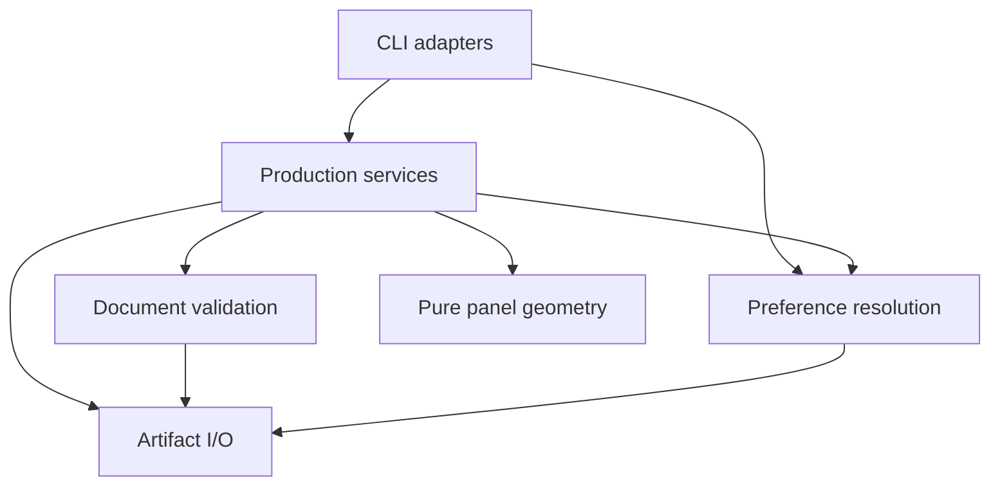

# Engineering architecture

## Scope and baseline

This is a local Python production toolkit and an Agent workflow, not a web
application. The baseline is `c43fa59` (2026-11-28 audit): 10 functional package
modules, 11 command adapters and 11 passing unittest cases. Runtime dependencies
are Python 3.10+ and Pillow. There is no server, database, cache, remote API
client, authentication service or retry worker.

The generic repository owns reusable code. The sibling novel workspaces have
the same tracked tree at audit time; they are not migration targets in this
change. User novels, reference art and outputs remain untracked.

## Business and state ownership

| Artifact / concept | Authoritative owner | Consumers / boundary |
| --- | --- | --- |
| Production preferences | `config/user-preferences.json` | Agent instructions and explicitly configured tools |
| Runtime defaults and preference rules | `novel_to_comic.config` | Production settings; CLI overrides take precedence |
| Source text / chapter manifest | `novel_to_comic.source` | Reader and adaptation roles; TXT and EPUB remain distinct input adapters |
| Narrative / visual bibles | Reader, character and setting roles | Downstream chapter roles; human approval markers are preserved |
| Page story plan | Manga story writer; `page_story_plan` validates | Script writer; `state` reads without mutation |
| Page script | Manga script writer; `page_script` validates | Storyboard and director roles; critical-information coverage belongs here |
| Storyboard | Storyboard writer | Image tasks, fallback rendering, QC |
| Director briefs | Manga page director; `director_briefs` validates | Artists; validation is independent of CLI parsing |
| Finished pages | Artists with disjoint page ranges | QC, reader and binder |
| Fallback page art / lettering | `compose` and `lettering` | Recovery and separate-layer workflows only |
| QC report | `qc` | Editor and read-only state interpreter |
| Approval markers | Human/editor workflow | `state` interprets existing names and precedence |
| PDF / CBZ | `bind` | Delivery; both formats are required by the current workflow |

The filesystem is the sole persistent state store. No in-memory registry or
cache should duplicate artifact truth. Text/JSON writes use one atomic persistence boundary;
this does not make a multi-file chapter transaction atomic. One Agent owns each
shared artifact. Artists may write different page ranges only after shared
script/storyboard/director inputs are approved.

For a fresh source ingest, publish chapter text first, the manifest next, and
`source/novel.txt` last. That last path is the existing state-completion signal.
An interrupted first ingest must remain at `phase0_ingest`. Re-ingestion of an
existing version is not a multi-file transaction and does not delete old chapters.

## Module boundaries

All public `TOOLS/*.py` commands remain available. They parse arguments, call
package services, print results and select exit codes. They do not own business
validation or image algorithms. Existing importable validator names are retained.

Dependencies always point inward from commands. Package modules must never
import command adapters. Pure validation and geometry must not import Pillow,
CLI argument parsing, process runners or production services. State interprets
artifacts and validators; it never generates pages or changes approvals. Pillow
belongs only in image operations, QC and binding. No package import cycles are
permitted. The implemented edge list is checked by the architecture tests.

| Module | Public entry points | Allowed internal dependencies |
| --- | --- | --- |
| `artifacts` | `read_json`, `write_json`, `write_text` | None |
| `config` | `load_preferences`, `validate_preferences`, `ProductionSettings`, `load_production_settings` | `artifacts` |
| `source` | `parse_txt`, `parse_epub`, `parse_source_file`, `write_parsed_source` | `artifacts` |
| `validation` | Shared diagnostic/file/page-list mechanics | `artifacts` |
| `page_story_plan` | `check_page_story_plan`, `validate_page_story_plan` | `validation` |
| `page_script` | `check_page_script`, `validate_page_script` | `validation` |
| `director_briefs` | `check_briefs`, `validate_director_brief` | `validation` |
| `state` | `detect_state` | Plan/script validators, `validation` |
| `image_tasks` | `build_image_tasks`, `write_image_tasks` | `artifacts`, `config` |
| `layout` | `panel_boxes` | None |
| `compose` | `compose_chapter_pages` | `artifacts`, `config`, `layout` |
| `lettering` | `normalize_page_image`, `normalize_directory`, `letter_chapter_pages` | `artifacts`, `config`, `layout` |
| `qc` | `qc_chapter` | `artifacts`, `config` |
| `bind` | `bind_pages` | None |

This table explains ownership; `tests/test_architecture.py` is the executable
authority for allowed edges. Its static checks do not prove semantic correctness
or detect every possible renamed copy of an algorithm; independent review remains
part of each batch.

## Public compatibility surface

- CLI file names, existing arguments, stdout JSON and successful exit behavior.
- Existing package entry points, validator re-exports and rendering size aliases.
- JSON fields, phase names, chapter/page paths and approval marker names.
- Existing default A4 canvas and legacy standalone command behavior.
- Explicit fallback lettering/composition, source formats and both export formats.
- No rewritten production artifacts, approval invalidations or destructive cleanup.

Malformed inputs may gain structured errors rather than tracebacks. Additive
configuration and finished-page-only QC are documented and regression tested.
Strict completion gates require a separate decision; existence-only checks are
not silently reinterpreted as approval of artifact contents.

## Audit inventory

| Area | Baseline entropy / deviation | Disposition |
| --- | --- | --- |
| UI and design system | No application UI; dimensions repeated in tools | Canonical production settings; preserve artistic role contracts |
| Domain models | Plan/script helpers repeated; distinct domain semantics | Share diagnostic mechanics, retain separate validators |
| Interfaces and data | Director rules in CLI; file and memory validation coupled | Package-owned pure validation plus stable file adapters |
| State and data flow | Three identical page-number readers; repeated reads | One validated script snapshot, no unused readers |
| Data access and cache | JSON writes copied; source completion published too early | Atomic UTF-8 text/JSON boundary; novel signal published last |
| Configuration | Preferences unused by production; language hardcoded Chinese | Explicit preference input; legacy defaults retained |
| Errors and retries | Decode/file/image errors inconsistently surfaced | Expected failures at owning boundary; no speculative retries |
| Observability | JSON stdout and workflow log directories | Preserve machine-readable output; no logging framework |
| Permissions and identity | Local OS/Git access; generated narrative plans not ignored | Preserve access model; complete runtime-artifact ignore coverage |
| Naming and boundaries | Compact package; no cycles; incomplete `__all__` | Keep layout, document APIs and enforce dependency direction |
| Utilities | Duplicate grid algorithm with different margins | One parameterized geometry function, preserve both policies |
| Tests and build | 11 cases, no CI or architectural checks | Characterization, contract tests, AST rules and CI |

## Parallel development

Use an isolated worktree and branch per independent task. Agree file ownership
and shared API signatures before edits. The integration branch alone owns shared
configuration, documentation and final validation. Each batch must migrate all
callers, remove replaced code, pass relevant tests and receive independent review
before integration. Commit only the task's files. Never force-push or merge to
the default branch as part of routine governance.

See [decisions](architecture-decisions.md), [progress](refactor-progress.md) and
[the task pool](refactor-backlog.md).
